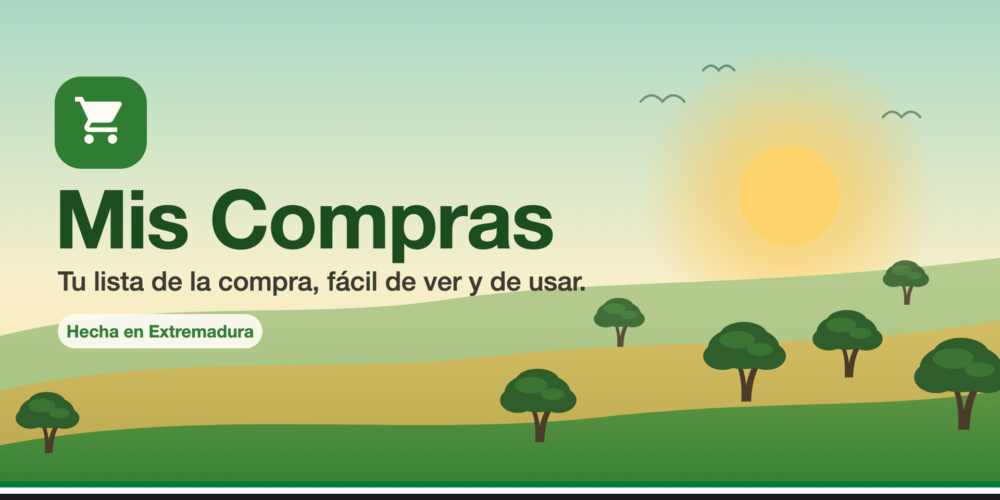
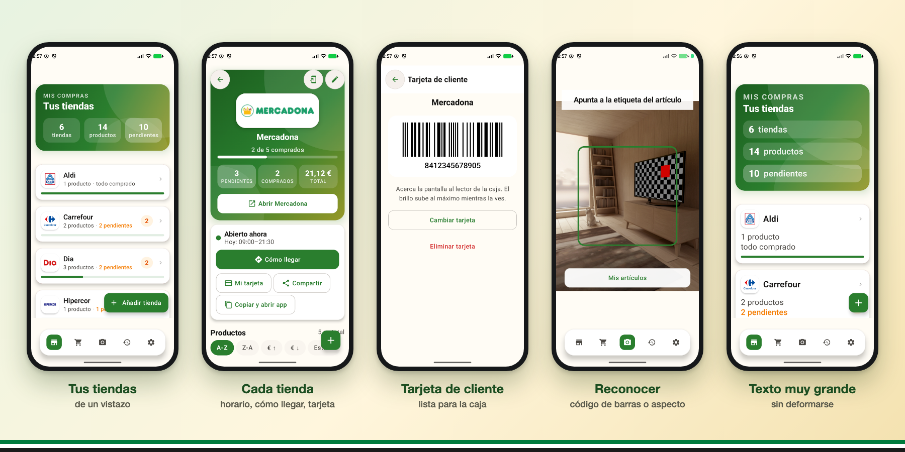
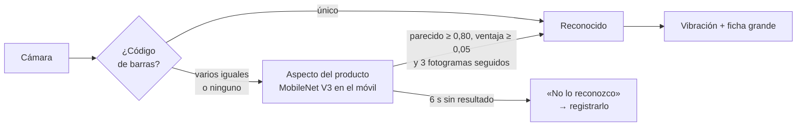
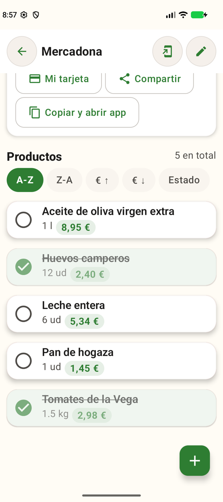
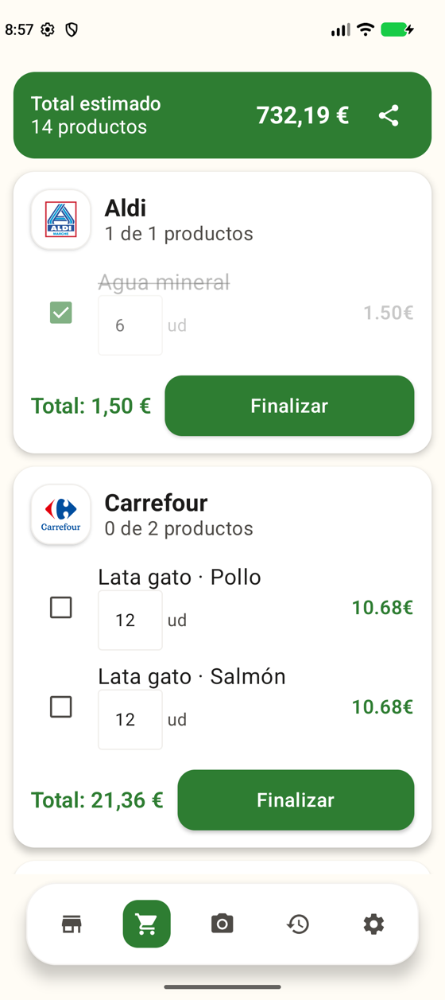
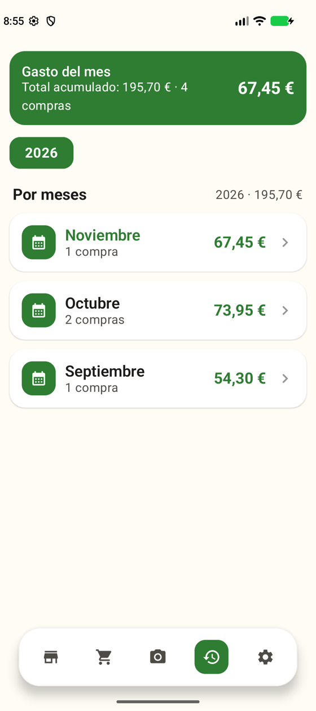
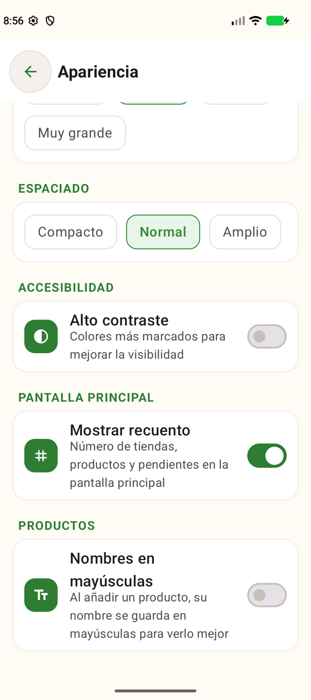

<div align="center">



# Mis Compras

**La lista de la compra pensada para que nadie se quede sin entender qué lleva en el carro.**
Organiza tus supermercados, reconoce los productos con la cámara y lleva tu tarjeta de cliente siempre a mano.


[](https://github.com/achojosan/mis-compras-android/actions/workflows/ci.yml)

**Hecha en Extremadura**

</div>

<br>



<sub>Capturas reales de la app con datos de demostración (productos extremeños: Torta del Casar, Queso de la Serena, Cerezas del Jerte, Pimentón de la Vera…).</sub>

---

> **Página de presentación y descarga:** <https://achojosan.github.io/mis-compras-android/> (el código está en [`docs/`](docs/index.html)). El botón de descarga baja directamente el APK de la [última versión](https://github.com/achojosan/mis-compras-android/releases/latest/download/mis-compras.apk) (versión actual: **1.11**).

## ¿Por qué existe?

Hay quien no puede fiarse de los ojos para distinguir un producto de otro. Dos latas de comida para gatos con **el mismo envase** y solo una pegatina distinta en la tapa para indicar el sabor; dos botes casi idénticos; una etiqueta demasiado pequeña. Mis Compras nació para resolver eso:

> Apuntas la cámara al producto → el móvil **vibra** → una pantalla con **letras enormes** te dice qué es.

Y alrededor de esa idea, todo lo que hace falta para hacer la compra sin complicaciones: tus supermercados, tu lista, tus gastos y tu tarjeta de cliente, con una interfaz que se adapta a quien la usa.

## Lo que hace

### Reconoce los productos
- **Código de barras primero**, leído en el propio móvil (EAN, UPC…). Si lo comparte un solo artículo, es inmediato.
- **Si no hay código, o varios artículos lo comparten**, compara el aspecto con las fotos que tú mismo registraste (por ejemplo, la pegatina de cada sabor). Funciona sin internet.
- Al reconocer algo: **vibración corta** y ficha con el nombre en tamaño enorme. Si no reconoce nada, lo avisa con una doble vibración y te deja registrarlo.
- Al registrar un código nuevo, puede **rellenar el nombre y las notas** con [Open Food Facts](https://world.openfoodfacts.org).



### Una cartera de tarjetas
Toda tu compra en un sitio, con el aspecto de una **cartera**: cada cosa tiene su propia tarjeta y se reconoce de un vistazo.
- **Tiendas como pases de color**: cada supermercado tiene su color (paleta de alto contraste) y puedes cambiarlo.
- **Lista como ticket**, con control **− / +** para las cantidades y marcado de lo comprado.
- **Artículos con color e icono propios**, y la palabra distintiva en grande en «Mis artículos».
- **Gastos con gráfico** por meses y barra inferior con etiquetas.
- La cámara, el alta de tarjeta y la ficha de cada tienda comparten el mismo mundo visual (cabecera con el pase de la tienda).
- Titulares en **Bricolage Grotesque** (licencia OFL), incluida en la app.

### Tus supermercados
- **Al instalarla, busca por ti** las cadenas que tienes cerca (con tu ubicación, solo en ese momento) y las añade: eliges cuáles.
- **Ficha de la tienda como un pase abierto**: cabecera con su color, estado de apertura y pendientes en grande; acciones en mosaicos con icono y texto (2 por fila con texto grande).
- Con **horario y «abierto/cerrado ahora»**, botón **Cómo llegar** y acceso a **la app oficial** de la cadena (Mercadona, Carrefour, Lidl, Aldi, Dia, Hipercor / El Corte Inglés, Alcampo, Consum, Eroski y BM).
- Línea **«Última compra»** calculada a partir del historial.
- **Tarjeta de cliente**: la escaneas una vez (o escribes el número) y se muestra a pantalla completa, con el brillo al máximo, lista para la caja.
- **Acceso directo** en la pantalla de inicio a cualquier tienda.

### La lista y los gastos
- Productos agrupados por tienda, con total estimado, cantidades editables y marcado de lo comprado.
- **Selector de orden** en los productos de cada tienda; los productos nuevos se añaden al final de la lista.
- Deslizar para borrar, igual en Tiendas, Lista y la ficha de la tienda.
- **Compartir la lista** (solo lo pendiente) por WhatsApp, correo…, o copiarla y abrir la app de la tienda.
- Historial de compras por meses, repetir una compra anterior con un toque.

### Se actualiza desde la propia app
- Al abrir la app avisa si hay una versión nueva en GitHub y la descarga e instala con un toque; no hace falta volver a la web.
- Antes de instalar comprueba el **SHA-256** del archivo, y Android exige además que lleve **la misma firma** que la app instalada.
- Se puede desactivar en Ajustes y también buscar a mano.
- Google Play Protect puede preguntar al final (no conoce la app): elige «Instalar sin analizar» o «Analizar app».

### Accesible de verdad
- **Tamaño de texto** pequeño, normal, grande y **muy grande**: las pantallas cambian a un diseño apilado para que ninguna tarjeta se deforme.
- **La escala de texto del sistema se respeta**: el tamaño efectivo es el del sistema × el de la app (con tope de 2,0), en lugar de pisarse.
- Espaciado, **alto contraste**, modo claro/oscuro/sistema y 7 colores de tema.
- Botones y zonas táctiles grandes (≥ 56 dp).
- ¿Demasiados números? **Mostrar recuento** se puede apagar, y la pantalla principal queda limpia.

<table>
  <tr>
    <td align="center"><br><sub>Productos</sub></td>
    <td align="center"><br><sub>Lista de la compra</sub></td>
    <td align="center"><br><sub>Gastos por meses</sub></td>
    <td align="center"><br><sub>Apariencia</sub></td>
  </tr>
</table>

## Privacidad: qué sale del móvil

Sin cuentas, sin anuncios, sin analíticas. Tus tiendas, productos, fotos y tarjeta **se guardan solo en el móvil**. Las imágenes de la cámara se procesan en el dispositivo y nunca se suben.

La app hace solo estas consultas a internet, y todas son opcionales:

| Cuándo | Qué se envía | A quién |
|---|---|---|
| «Buscar tiendas cercanas» (al empezar) o «Buscar sucursal» | Tus coordenadas aproximadas | Servidores públicos de [Overpass](https://overpass-api.de) (OpenStreetMap) |
| Registrar un artículo con código de barras | Solo ese código | [Open Food Facts](https://world.openfoodfacts.org) |
| Al abrir la app (como mucho una vez al día) o «Buscar actualizaciones» | Una petición a la API de GitHub para saber si hay versión nueva (tu IP, sin datos personales) | [GitHub](https://github.com) |

El aviso de actualizaciones se puede **desactivar** en Ajustes. El permiso de ubicación puede ser **aproximado**. Aparte, el sistema Android puede incluir los datos de la app en su copia de seguridad, como con cualquier otra app.

## Para desarrolladores

**Requisitos:** Android Studio reciente (o JDK 21) y un móvil o emulador con **Android 12 (API 31)** o superior.

```bash
git clone https://github.com/achojosan/mis-compras-android.git
cd mis-compras-android

./gradlew testDebugUnitTest      # tests unitarios
./gradlew assembleDebug          # APK de depuración en app/build/outputs/apk/debug/
```

**Diseño y producto:** el contexto de producto está en [`PRODUCT.md`](PRODUCT.md) y el sistema de diseño («La cartera») en [`DESIGN.md`](DESIGN.md).

**Web (`docs/`):** página estática con scroll animado con GSAP 3.15 + ScrollTrigger, alojado en el propio repositorio (`docs/vendor/gsap`, sin terceros). Hay una variante ligera sin JavaScript o con «reducir movimiento».

**Actualizador integrado:** usa el permiso `REQUEST_INSTALL_PACKAGES`, que Google Play restringe. Una futura versión para Play debería compilarse sin el actualizador.

**APK firmado (release):** la firma no está en el repositorio. Copia `keystore.properties.example` a `keystore.properties` (ignorado por git), pon los datos de tu keystore y ejecuta `./gradlew assembleRelease`. Sin ese fichero se genera un APK **sin firmar**.

**Publicar una versión:** sube `versionCode` y `versionName` en `app/build.gradle.kts`, compila el release y publícalo con el APK adjunto con el nombre fijo `mis-compras.apk` (la web enlaza a `releases/latest/download/mis-compras.apk`). El APK release solo lleva librerías **arm64** (~78 MB).

### Cómo está hecha

| Capa | Tecnología |
|---|---|
| Interfaz | Jetpack Compose · Material 3 · Navigation Compose · Coil (logos SVG) · Bricolage Grotesque |
| Datos | Room (migraciones 2→3→4→5→6) · DataStore · Hilt |
| Cámara y lectura | CameraX · ML Kit Barcode Scanning (en el dispositivo) |
| Reconocimiento visual | MediaPipe Image Embedder (MobileNet V3 small, incluido en la app) |
| Tarjeta de cliente | ZXing (dibuja de nuevo el código leído) |
| Red | OkHttp · kotlinx.serialization (Overpass y Open Food Facts) |
| Ubicación | Fused Location Provider (Google Play Services) |

```
app/src/main/java/app/miscompras/com/
├── data/         Room, DataStore, repositorios y clientes remotos (osm/, off/)
├── domain/model/ Entidades: Supermarket, Product, KnownItem, ItemReference…
├── recognition/  Lectura de códigos, embeddings y decisión de reconocimiento
├── nearby/       Cadenas conocidas, distancias y parser de «opening_hours»
├── location/     Posición actual con respaldo (red → GPS → última conocida)
├── ui/           Pantallas, componentes, navegación y tema
└── util/         Compartir lista, accesos directos, enlaces a mapas y apps
```

La lógica delicada es **pura Kotlin y está probada** (más de 40 tests con datos reales de OpenStreetMap y Open Food Facts): decisión de reconocimiento, intérprete de horarios, emparejado de cadenas, generación del código de la tarjeta, formateo de la lista y enlaces.

El proyecto cumple con tamaños de página de **16 KB** (requisito de Android 15+): se comprobó que las librerías nativas van alineadas.

## Limitaciones conocidas

- Los umbrales del reconocimiento visual (`RecognitionConfig`) son una primera estimación; hay que **calibrarlos con latas reales** de aspecto casi idéntico.
- Los servidores públicos de Overpass se saturan a veces: la app prueba un segundo servidor y, si no hay suerte, deja continuar sin tiendas.
- Solo está en **español**.

## Agradecimientos y datos

- Mapas: © [colaboradores de OpenStreetMap](https://www.openstreetmap.org/copyright) (licencia ODbL).
- Productos: [Open Food Facts](https://world.openfoodfacts.org) (licencia ODbL).
- Modelo de reconocimiento visual: MobileNet V3 small de los modelos de [MediaPipe](https://ai.google.dev/edge/mediapipe) (Google).
- Tipografía de la web: Bricolage Grotesque, © The Bricolage Grotesque Project Authors (SIL OFL 1.1).
- Los logotipos de las cadenas pertenecen a sus propietarios y se usan solo para identificar cada tienda. Mis Compras es independiente y no está afiliada a ninguna de ellas.

## Licencia

El código y el material de este repositorio se publican bajo la **[PolyForm Strict License 1.0.0](LICENSE)** (SPDX: `PolyForm-Strict-1.0.0`), más un permiso adicional.

| Puedes | No puedes |
|---|---|
| Instalar y usar la app para fines **no comerciales** (personales, hobby, estudio, organizaciones sin ánimo de lucro) | Usarla con fines comerciales |
| Leer el código | Copiarlo, modificarlo, crear versiones derivadas ni reutilizar su código o sus recursos |
| Compartir el enlace a la web o a las [versiones oficiales](https://github.com/achojosan/mis-compras-android/releases) y entregar a otras personas el **APK oficial sin modificar** | Redistribuir una versión modificada ni publicarla en otras tiendas de aplicaciones |

Los textos, imágenes, capturas y el banner son © 2026 Josan, **todos los derechos reservados**. Los logotipos de las cadenas son de sus propietarios, y las bibliotecas y datos de terceros mantienen sus licencias. GitHub permite ver y bifurcar los repositorios públicos dentro de su plataforma, pero eso no concede más derechos. Esto no es asesoramiento legal.

---

<div align="center">

Hecho con cariño en **Extremadura** por **Josan** ([@achojosan](https://github.com/achojosan)) · [achojosan@proton.me](mailto:achojosan@proton.me)

<sub>Las tres franjas de color del banner —verde, blanco y negro— son un guiño a la bandera de Extremadura.</sub>

</div>
